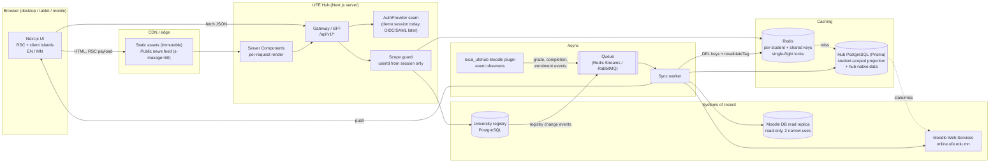

# 1. Architecture plan

The hub is a **Next.js App Router frontend** backed by a **REST gateway (BFF)** that aggregates Moodle, the university registry and notification queues into student-scoped responses. In the prototype the gateway is a set of Next.js route handlers reading seed data; the boundaries below are drawn so each piece can be swapped for the real thing without touching the UI.

## 1.1 System diagram



## 1.2 Components

| Layer | Responsibility | Prototype | Production |
|---|---|---|---|
| Frontend | App shell, My courses, cards, drawers; bilingual chrome; Mongolian titles verbatim | Next.js 16, Tailwind v4, seed data | Same |
| Auth seam | Turns a request into a `Session { userId, studentNo, locale, roles }` | `DemoAuthProvider` returns the seed student | `OidcAuthProvider` / `SamlAuthProvider` against the university IdP (out of scope for now, see assumptions §1) |
| Gateway (BFF) | Aggregates sources, enforces scoping, shapes DTOs for components | `HubDataSource` interface with `SeedDataSource` | `MoodleDataSource` + `RegistryDataSource`, can be extracted from Next.js into its own service |
| Projection DB | Last-known-good copy of each student's courses, grades, deadlines; owns tickets, lost & found, office hours | Prisma schema only | PostgreSQL 16 with row-level security |
| Redis | Hot per-student cache, shared course metadata, single-flight locks, rate limits | Not used | Redis 7 (cluster for exam weeks) |
| Queue + worker | Applies change events from Moodle and registry, invalidates caches, fans out notifications | Not used | Redis Streams or RabbitMQ; one worker pool |

## 1.3 Authentication (seam only)

SSO is out of scope for this prototype. The gateway depends on one interface:

```ts
interface AuthProvider {
  getSession(req: Request): Promise<Session | null>;   // null → 401
}
```

The UI never sees tokens. When SSO comes back, an OIDC or SAML provider implements this interface, maps the IdP subject to `User.ssoSubject` / `User.moodleUserId` / `User.registryStudentNo`, and nothing above it changes. The "90 % fewer external logins" goal (assumptions §2) depends on this: without a shared identity, the hub can still remove *most* logins by holding the one session and calling Moodle and the registry server-to-server with service credentials.

## 1.4 Data sources

### Moodle Web Services (preferred)

| Need | Function |
|---|---|
| Site/user info, language | `core_webservice_get_site_info` |
| My courses list, image, progress, last access, favourite | `core_course_get_enrolled_courses_by_timeline_classification` (`classification=all`) |
| Enrolment status, `lastaccess`, `completed` | `core_enrol_get_users_courses` |
| Teachers on a card (course contacts) | `core_course_get_courses_by_field` → `contacts[]` |
| Teacher avatars | `core_user_get_users_by_field` → `profileimageurl` (only for contacts) |
| Course grade for the pill | `gradereport_overview_get_course_grades` |
| Grade items and weights for the what-if calculator | `gradereport_user_get_grade_items` |
| Deadlines | `core_calendar_get_action_events_by_timesort`, `mod_assign_get_assignments` |
| Course alerts for the bell | `message_popup_get_popup_notifications`, `core_message_get_unread_conversations_count` |

### Moodle DB read replica (read-only, only where the API falls short)

1. **Grade category aggregation** for the what-if calculator. `gradereport_user_get_grade_items` returns item weights but not the category aggregation method or extra-credit flags, which the simulator needs to be correct. Read `mdl_grade_categories.aggregation` and `mdl_grade_items.aggregationcoef` / `aggregationcoef2` for the student's courses.
2. **Bulk warm-up before peak weeks.** Calling the per-user WS functions for every student at 06:00 is thousands of requests. One replica query over `mdl_user_enrolments`, `mdl_enrol`, `mdl_course` and `mdl_course_completions` builds the projection for everyone at once.

Everything else goes through Web Services, so Moodle's own permission checks still apply. The replica user has `SELECT` on those tables only.

### University registry (PostgreSQL)

Official term and cumulative GPA, credits earned, programme requirements and prerequisites (for the degree audit), exam timetable and rooms, weekly timetable. Accessed through a read-only role with views that already filter by `student_no`.

### Notification queues

- `local_ufehub` (a small Moodle local plugin) observes `\core\event\user_graded`, `\core\event\course_module_completion_updated`, `\core\event\user_enrolment_created|updated|deleted`, `\core\event\course_updated` and publishes `{type, moodleUserId, courseId, at}`.
- The registry publishes grade postings, timetable changes and official announcements.
- The sync worker consumes both, updates the projection, invalidates caches and pushes a notification to the student's open tabs (Server-Sent Events). The bell merges course alerts and campus notices from this one stream.

## 1.5 Request flow: opening My courses

1. Browser requests `/my`. The CDN serves cached static chunks; the HTML is rendered per request by a Server Component (never CDN-cached, it is personal).
2. The server calls `AuthProvider.getSession()`. No session → redirect to sign-in (demo: auto session).
3. The gateway's scope guard takes `userId` **from the session**. No endpoint accepts a user id from the query string or body.
4. `GET courses(userId)` reads Redis key `s:{userId}:courses:v3`. On a hit it returns immediately.
5. On a miss it takes a single-flight lock (so 500 refreshes during exam week cause one upstream call), reads the projection, and if the projection is older than its freshness window, calls Moodle WS, writes the projection and the Redis key, and releases the lock.
6. The page streams: the shell and grid render first; grade pills and the news banner stream in behind `<Suspense>` so a slow grade call never blocks First Contentful Paint.
7. A grade posted in Moodle fires `user_graded` → queue → worker refreshes that one course's grade, deletes `s:{userId}:grades`, calls `revalidateTag("user:{userId}:grades")`, and pushes an SSE message. The pill updates without a reload; this is what makes it "live".

## 1.6 Caching layers and invalidation

| Layer | What | Key / scope | TTL (normal → peak) | Invalidated by |
|---|---|---|---|---|
| L0 Browser | Hashed JS/CSS/fonts, generated card headers (inline SVG, no request) | per file | 1 year, `immutable` | new deploy (new hash) |
| L1 CDN | Static assets; public news feed and campus notices | URL | 60 s → 300 s, `stale-while-revalidate=600` | purge on announcement publish |
| L2 Next.js data cache | Shared, non-personal data: course metadata, term calendar, public announcements | `cacheTag("course:{id}")`, `cacheTag("news")` | 1 h → 6 h | `revalidateTag` from the worker |
| L3 Redis | Per-student DTOs: courses, grades, deadlines, unread count | `s:{userId}:{resource}:v{schema}` | 5 min → 30 min, served stale up to 2 h if upstream is down | worker `DEL` on matching event; schema bump changes the key |
| L4 Projection DB | Last-known-good per student | row per user/course | freshness window 15 min → 60 min | worker upsert on event; nightly full reconcile |

**Principles**

- Personal data is never cached at the CDN or in a shared cache entry. Every per-student key starts with the user id, and the code that builds keys is the same function that enforces scoping.
- **Events invalidate, TTLs are only the backstop.** That is why TTLs can be long during exam week without grades going stale.
- **Peak mode** (registration and exam weeks, a flag set by the registry calendar): longer TTLs, 06:00 bulk warm-up from the replica, a token-bucket limiter on outbound Moodle calls, and non-critical widgets (news ticker images, avatars) degrade first.
- If Moodle is down, the hub serves the projection with a "Last updated 14:05" note rather than an error.

## 1.7 Data protection

The hub processes students' personal data, so it is designed around Mongolia's Law on Personal Data Protection and FERPA-style principles. This is an engineering design, not legal advice; the university's data-protection officer should review it.

- **Scoping.** `userId` only ever comes from the session. Projection tables carry `userId`, and PostgreSQL row-level security (`USING (user_id = current_setting('app.user_id')::uuid)`) blocks cross-student reads even if application code has a bug.
- **Minimisation.** The projection stores only what the UI shows. No national ID (регистрийн дугаар), address or financial data is copied from the registry.
- **Instructor photos** are shown only to students enrolled in that course; avatar URLs are proxied through the hub with short-lived signed URLs.
- **Audit.** Every read of grades or GPA and every staff action on a ticket or lost-and-found claim writes an `AuditLog` row (who, what, when, from where).
- **Retention.** Projection rows for a course are purged 1 year after the term ends; lost-and-found photos 90 days after closure; tickets per university policy.
- **Transport and storage.** TLS everywhere, encrypted volumes, secrets in a vault, data hosted in Mongolia unless the DPO approves otherwise.
- **Subject rights.** Export and correction requests are routed through the helpdesk's Academic Registry queue.

## 1.8 Frontend

- **Rendering.** Server Components by default; client components only for interactive islands (sidebar search/filter, notification dropdown, drawer, language toggle).
- **Performance budget for FCP < 1.2 s.** No client-side data fetching for first paint; fonts self-hosted via `next/font` with `display: swap` and only the Latin + Cyrillic subsets; course headers are inline SVG (no image requests); total first-load JS under 120 KB gzip.
- **i18n.** Chrome strings in `messages/{en,mn}.ts`; locale stored in a cookie; `<html lang>` follows the locale. Course titles are data and are never passed through translation.
- **Accessibility.** Landmarks (`header`, `nav`, `main`), skip link, visible focus ring, all interactive widgets operable by keyboard. Widget-specific behaviour is documented in `03-component-architecture.md`.
