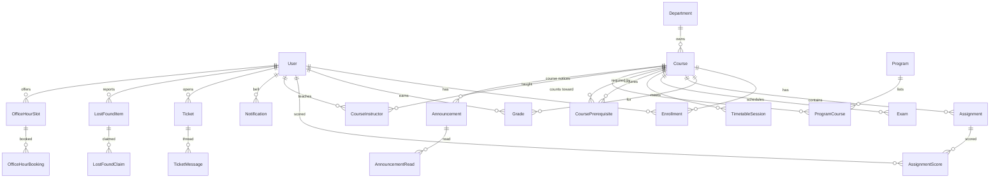

# 2. Database schema

The full schema is [`prisma/schema.prisma`](../prisma/schema.prisma) (Prisma 7, PostgreSQL; `npx prisma validate` passes). This page explains the shape and the decisions behind it.

## What this database is

The hub's own PostgreSQL holds two kinds of data:

- **Projection** of Moodle and the registry, scoped per student: `Course`, `Enrollment`, `Grade`, `Assignment`, `AssignmentScore`, `Exam`, `TimetableSession`. These rows carry `syncedAt` and external ids (`moodleCourseId`, `moodleItemId`, `registryId`) and are overwritten by the sync worker. Moodle and the registry stay the systems of record.
- **Hub-native data** the hub owns: `Ticket`, `TicketMessage`, `LostFoundItem`, `LostFoundClaim`, `OfficeHourSlot`, `OfficeHourBooking`, `Notification`, `AnnouncementRead`, `AuditLog`.

## Model map



## Required models and where the brief's fields live

| Brief | Model / fields |
|---|---|
| User (profile + SSO identifiers) | `User`: `firstName`, `lastName`, `displayInitials`, `avatarUrl`, `locale`; identity links `ssoSubject` + `ssoIssuer` (null until SSO exists), `moodleUserId`, `registryStudentNo` |
| Course (code, MN title, EN title, semester, year, header image, status) | `Course`: `code`, `titleMn`, `titleEn`, `semester`, `academicYear`, `headerImageUrl` + `headerPattern` fallback, `status`; plus `termBadgeMn` (see assumptions §7) and `credits` |
| Enrollment (user ↔ course, progress %, access status) | `Enrollment`: `progressPercent` (null when tracking is off), `accessStatus` enum mapping to the card footer |
| Grade (percentage, letter, last updated) | `Grade`: `percentage`, `letterGrade`, `gradePoints`, `lastUpdated`; one row per `source` (MOODLE live / REGISTRY official) |
| Assignment (due dates, weights) | `Assignment`: `dueAt`, `weightPercent`, `maxPoints`, `categoryName`, `isExtraCredit`; student scores in `AssignmentScore` (null = pending, the what-if input) |
| Exam (date, time, room, type) | `Exam`: `startsAt` / `endsAt` (UTC, shown in Asia/Ulaanbaatar), `room`, `building`, `type` |
| Announcement (source, category, priority) | `Announcement`: `source` (Department / Academic Registry / Student Events / Course / System), `category`, `priority`, bilingual title/body |
| Ticket | `Ticket` + `TicketMessage` (categories IT / Tuition / Academic Registry; `isInternal` staff notes) |
| LostFoundItem | `LostFoundItem` + `LostFoundClaim` (claim verification via a private `verificationHint` and a staff `verifiedBy`) |
| OfficeHourSlot | `OfficeHourSlot` + `OfficeHourBooking` (capacity, online/in-person) |
| Prerequisites | `CoursePrerequisite` self-relation with `minGrade` and `groupNo` (same group = OR, different groups = AND); `Program` + `ProgramCourse` give credit targets for the audit |

## Audit and soft delete

- `createdAt`, `updatedAt`, `deletedAt`, `createdById` on every entity people create or edit (courses, assignments, exams, announcements, tickets, items, slots).
- Join and log tables (`AnnouncementRead`, `AuditLog`, `CoursePrerequisite`) are append-only, so they have `createdAt` only.
- `AuditLog` records grade/GPA reads and staff actions (`subjectUserId` = whose data was touched).
- Queries filter `deletedAt IS NULL`; the indexes that serve list views include `deletedAt` so this stays cheap.

## Indexes, by the query they serve

| Query | Index |
|---|---|
| My courses for a student | `Enrollment(userId, deletedAt, accessStatus)` + unique `(userId, courseId)` |
| Grade pills for a student | `Grade(userId, source, deletedAt)` |
| Upcoming deadlines | `Assignment(courseId, dueAt)`, `Assignment(dueAt)` |
| Exam timetable / countdown | `Exam(courseId, startsAt)`, `Exam(startsAt)` |
| Weekly grid | `TimetableSession(dayOfWeek, startMinute)` |
| Degree audit (who depends on X) | `CoursePrerequisite(prerequisiteId)` |
| News channel filter | `Announcement(source, publishedAt desc)` |
| Unread bell | `Notification(userId, readAt, createdAt desc)`; unique `(userId, sourceRef)` makes event fan-out idempotent |
| Student's tickets | `Ticket(requesterId, status, updatedAt desc)`; staff queues by `(category, status, createdAt)` |
| Free office-hour slots | `OfficeHourSlot(status, startsAt)` |

## Row-level security (production)

Prisma does not express RLS, so it goes in a SQL migration. Each per-student table gets a policy like:

```sql
ALTER TABLE "Enrollment" ENABLE ROW LEVEL SECURITY;
CREATE POLICY enrollment_owner ON "Enrollment"
  USING ("userId" = current_setting('app.user_id')::uuid);
```

The gateway sets `app.user_id` from the session at the start of each transaction (`SET LOCAL`). Staff tools use a separate role with audited bypass.
